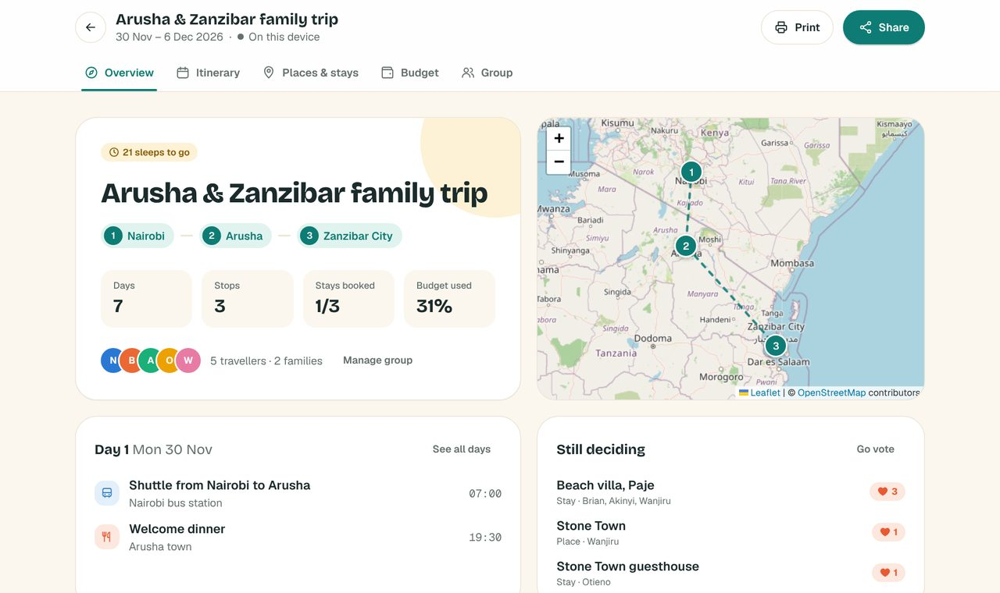
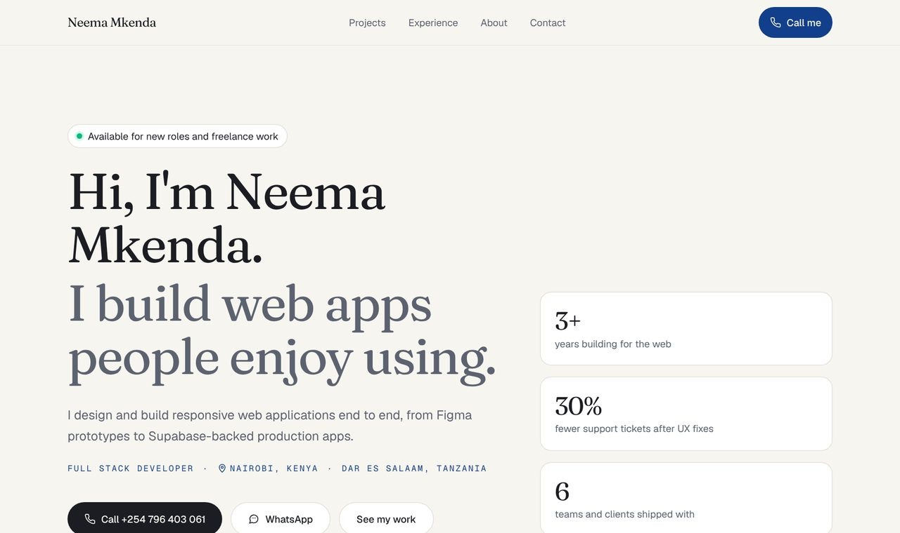

<div align="center">

<a href="https://neema-portfolio-pearl.vercel.app">
  
</a>

I design and build responsive web apps end to end, from the first Figma frame to a deployed, tested product.<br/>
Based in **Nairobi, Kenya** and **Dar es Salaam, Tanzania**.

<a href="https://neema-portfolio-pearl.vercel.app"></a>
<a href="https://www.linkedin.com/in/neema-mkenda-bb52b4200/"></a>
<a href="https://www.behance.net/neemarhonnahmkenda"></a>
<a href="mailto:nmkenda98@gmail.com"></a>

</div>

<br/>

## About me

```ts
const neema = {
  role: "Full Stack Developer & UI/UX Designer",
  experience: "3+ years shipping web apps",
  basedIn: ["Nairobi, Kenya", "Dar es Salaam, Tanzania"],
  currently: [
    "Web Support Executive @ Advance Services",
    "IT Specialist @ RCRO, building a healthcare web platform",
  ],
  stack: {
    frontend: ["React", "Next.js", "Vue", "TypeScript", "Tailwind"],
    backend: ["Node.js", "Python", "Django", "REST APIs", "Supabase / PostgreSQL"],
    design: ["Figma", "Usability testing", "UAT"],
  },
  proudOf: "UX fixes that cut support tickets by 30%",
  shipping: "Waypoint, a travel planner for families and friends",
  openTo: ["Full-time roles", "Freelance projects"],
  funFact: "I dance it out on a stressful day",
};
```

<br/>

## Featured work

<table>
  <tr>
    <td width="50%" valign="top">
      <a href="https://neema-portfolio-pearl.vercel.app/waypoint"></a>
      <h3>Waypoint</h3>
      <p>A travel planner for families and friends. Build day-by-day itineraries, map the route, vote on where to stay, and split costs by person or by family. Groups share a trip with edit and view links, no accounts needed.</p>
      <p>
        
        
        
        
        
      </p>
      <b><a href="https://neema-portfolio-pearl.vercel.app/waypoint">Live demo</a></b> · <a href="https://github.com/NeemaRhonnahMkenda/waypoint">Code</a>
    </td>
    <td width="50%" valign="top">
      <a href="https://neema-portfolio-pearl.vercel.app"></a>
      <h3>Portfolio</h3>
      <p>My personal site, and the home for every project I ship. Each project keeps its own repo and is pulled into one Vercel deployment at build time. Includes SEO metadata, structured data and generated share images.</p>
      <p>
        
        
        
        
      </p>
      <b><a href="https://neema-portfolio-pearl.vercel.app">Visit</a></b> · <a href="https://github.com/NeemaRhonnahMkenda/neema-portfolio">Code</a>
    </td>
  </tr>
  <tr>
    <td width="50%" valign="top">
      <h3>The Archive</h3>
      <p>A private family library: catalogue books, share collections and invite family members. Role-based access is enforced in the database with Supabase Row Level Security, with ISBN lookups from the Open Library API.</p>
      <p>
        
        
        
      </p>
      <i>Private repo. Happy to give a walkthrough.</i>
    </td>
    <td width="50%" valign="top">
      <h3>Culinary Canvas</h3>
      <p>A recipe-sharing blog where people sign up, publish recipes with photos, and browse by category or search.</p>
      <p>
        
        
        
      </p>
      <a href="https://github.com/NeemaRhonnahMkenda/CulinaryCanvasProject">Code</a>
    </td>
  </tr>
</table>

<br/>

## Toolbox

<table>
  <tr>
    <td><b>Frontend</b></td>
    <td></td>
  </tr>
  <tr>
    <td><b>Backend & data</b></td>
    <td></td>
  </tr>
  <tr>
    <td><b>Design & delivery</b></td>
    <td></td>
  </tr>
</table>

<br/>

## Experience

<details>
<summary><b>Career timeline</b> (click to expand)</summary>
<br/>

| When | Role | What I did |
| --- | --- | --- |
| Jun 2025 – now | **Web Support Executive**, Advance Services | Maintain and improve eCommerce sites: frontend, SEO, performance and responsive design. |
| Oct 2024 – now | **IT Specialist**, RCRO | Designed and built a responsive healthcare web platform, frontend to backend integration and deployment. |
| Oct 2023 – Jan 2026 | **Lead Software Engineer & UI/UX Designer**, EA Eye | Led frontend and UI/UX for a production web app. Usability fixes cut support tickets by 30%. |
| May 2024 – May 2025 | **Software Engineer**, Global Spark | Built reusable React components from product specs in an agile team. |
| Jun 2024 – Jul 2025 | **Freelance Web Developer**, Batian Consulting | WordPress builds, cross-browser testing, deployment and client training. |
| Aug – Sep 2023 | **Job Shadow Trainee**, Diamond Trust Bank | UAT for digital banking tools; turned issues into design feedback. |

</details>

<details>
<summary><b>Education & certifications</b> (click to expand)</summary>
<br/>

**BSc Applied Computer Technology**, United States International University – Africa (2021 – 2024), CGPA 3.50/4.00

- Women Techsters Bootcamp: Product Design, *Tech4Dev*
- Responsive Web Design, *freeCodeCamp*
- Introduction to Python Programming, *Dataquest*
- Python Fundamentals of Web Development, *Dataquest*

</details>

<br/>

## Activity

<picture>
  <source media="(prefers-color-scheme: dark)" srcset="https://raw.githubusercontent.com/NeemaRhonnahMkenda/NeemaRhonnahMkenda/output/github-snake-dark.svg" />
  <source media="(prefers-color-scheme: light)" srcset="https://raw.githubusercontent.com/NeemaRhonnahMkenda/NeemaRhonnahMkenda/output/github-snake.svg" />
  
</picture>

<br/>

<div align="center">

### Let's build something

Have a role, a project or a messy idea that needs a clean interface? I'd love to hear about it.

<a href="mailto:nmkenda98@gmail.com"><b>nmkenda98@gmail.com</b></a>

<br/><br/>


</div>
